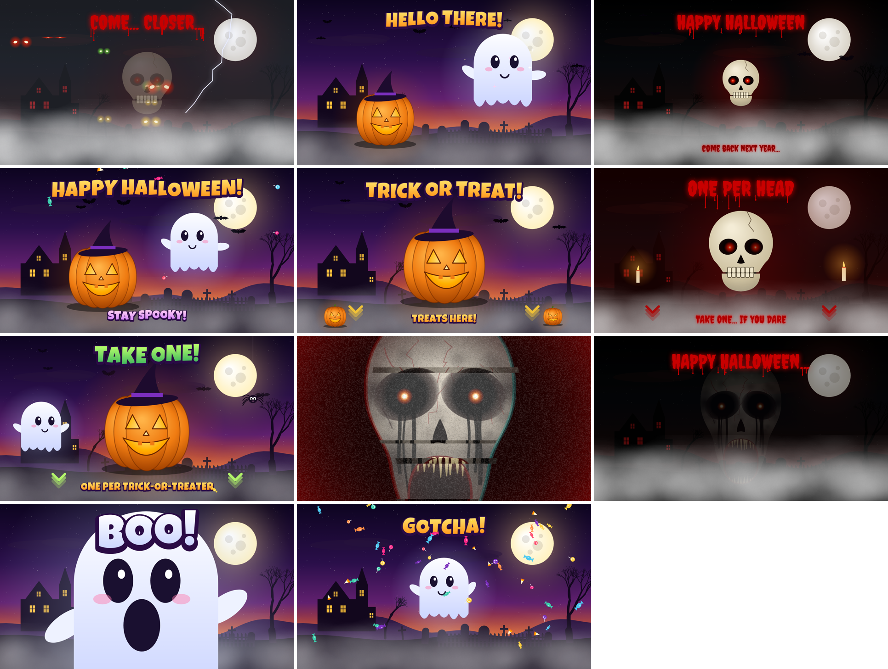
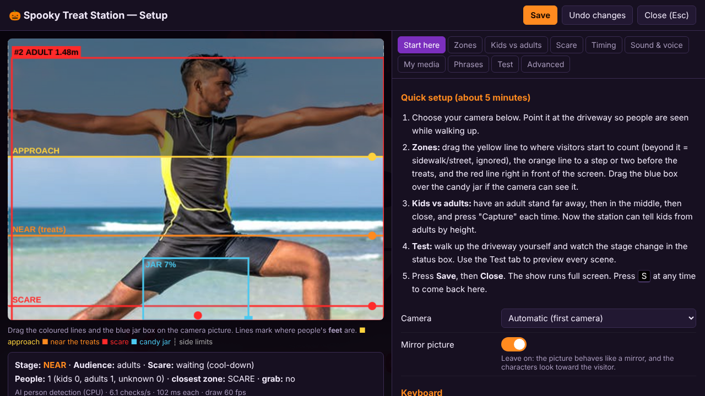

# 🎃 Spooky Treat Station

A Halloween display for your front door. You need a big screen, a webcam and speakers, with a bowl of candy in front.

It **invites** trick-or-treaters up the driveway, **welcomes** them, works out whether they're **kids or adults**, tells them to **take one treat**, and **scares them** when they reach in: a friendly cartoon "BOO!" for kids and a proper jump scare for adults.

Everything runs **on your own PC**: no internet, no cloud, no account, and nothing is recorded. It runs fine on a cheap Intel Celeron with 8 GB RAM.



---

## How it works

```
 nobody there          someone walks up        at the treats          reaches in / very close        they leave
 ┌────────────┐        ┌──────────────┐        ┌──────────────┐        ┌───────────────┐             ┌──────────┐
 │  INVITE    │ ─────▶ │   WELCOME    │ ─────▶ │  TAKE ONE!   │ ─────▶ │    SCARE!     │ ──────────▶ │ GOODBYE  │ ──▶ invite
 │ "Trick or  │        │ kids: ghost  │        │ kids: pumpkin│        │ kids: BOO! +  │             │ "Happy   │
 │  treat!"   │        │ adults: eyes │        │ adults: skull│        │ candy confetti│             │Halloween"│
 └────────────┘        │ in the dark  │        └──────────────┘        │ adults: jump  │             └──────────┘
                       └──────────────┘                                │ scare+scream  │
                                                                       └───────────────┘
```

* **Person detection:** Google MediaPipe's EfficientDet-Lite0 model runs locally in a background thread, so the animation never stutters.
* **Kids vs adults:** on flat ground, a person's height in the picture depends on how far away they are. After a quick calibration (an adult stands at 2–3 spots), the station estimates every visitor's real height in metres. Shorter than 1.40 m (adjustable) counts as a kid. Mixed groups get the gentler kids version by default.
* **Distance:** you drag three lines on the live camera picture (approach, near, scare). They mark where people's feet are. When the feet are below the bottom of the picture, the station works out where they would be from the person's height.
* **Candy grab (optional):** switch on *Watch the candy jar* and drag a box over the jar in the camera picture. A hand reaching into it, while someone is at the treats, triggers the scare. Optional extra hand tracking is available.
* **The characters look at the visitor.** The pumpkin, ghost and skull turn their eyes towards whoever is closest.
* **Everything is built in.** All animations, music, sound effects and voices are generated by code, so it works offline out of the box. You can still add **your own videos, pictures and sounds** for any stage.

## What you need

| | |
|---|---|
| Computer | **Windows 10/11** or **Linux** (64-bit PC: Ubuntu, Mint, Debian, Fedora…). An Intel Celeron or better |
| Memory | 4 GB minimum, 8 GB recommended (the show uses about 1–2 GB) |
| Disk | 154 MB download (Linux: 165 MB), about 300 MB installed |
| Camera | any USB webcam (720p is plenty) |
| Screen | a monitor or TV, the bigger the better |
| Sound | any speakers (louder is better outdoors) |
| Browser | Windows: Microsoft Edge (already installed). Linux: Google Chrome, Chromium or Edge (`install.sh` checks for one and can install Chrome for you) |
| Internet | only for the download. The show runs fully offline |

## Quick start (Windows)

1. Download **`SpookyTreatStation-vX.Y.Z-windows.zip`** from the [Releases page](../../releases).
2. Unzip it somewhere permanent, e.g. `C:\SpookyTreatStation`.
3. Double-click **`Setup Mode.bat`**.
   > Windows may say *"Windows protected your PC"* because the program isn't signed by a company. Click **More info → Run anyway**.
4. Follow the **Start here** tab: pick the camera, drag the zone lines, calibrate kids vs adults, and press **Save**.
5. Press **Close**. The show starts right away, full screen, with no restart. Press **S** at any time for setup. Next time, just start **`SpookyTreatStation.exe`**.

To start the show automatically when the PC boots, run **`Start with Windows - ON.bat`** and turn on Windows automatic sign-in.

## Quick start (Linux)

1. Download **`SpookyTreatStation-vX.Y.Z-linux-x64.tar.gz`** from the [Releases page](../../releases).
2. Unpack it and run the one-time setup:
   ```bash
   tar -xzf SpookyTreatStation-*-linux-x64.tar.gz -C ~
   cd ~/SpookyTreatStation
   ./install.sh
   ```
   `install.sh` checks for Google Chrome, Chromium or Edge. If none is installed, it offers to install Google Chrome (on Ubuntu, Mint, Debian and Fedora; it needs your password). It then adds **Spooky Treat Station** and **Spooky Treat Station Setup** to your applications menu and desktop.
3. Open **Spooky Treat Station Setup** (or run `./setup-mode.sh`) and follow the **Start here** tab, then **Save** and **Close**.
4. Next time, open **Spooky Treat Station** from the menu. To start it automatically at login, run `./autostart-on.sh`.

Linux notes: the program blocks system sleep while it runs (through systemd). With Ubuntu's snap Chromium, run `sudo snap connect chromium:camera` once if there's no camera picture. Raspberry Pi / ARM isn't packaged yet. See `README-LINUX.txt` in the package.

## Setting it up at the door

```
              street / sidewalk  (above the yellow line = ignored)
   - - - - - - - - - - - - - - - - - - - - - - - - - -   APPROACH line (yellow)
                     driveway / path
   - - - - - - - - - - - - - - - - - - - - - - - - - -   NEAR line (orange)  ~1–2 steps before the table
                    [ treats table ]
   - - - - - - - - - - - - - - - - - - - - - - - - - -   SCARE line (red)    right in front
             ┌──────────── BIG SCREEN ────────────┐
             │                                    │   camera on top of / beside the screen,
             └────────────────────────────────────┘   looking down the path at chest height
                     🔊 speakers      🖥 PC + keyboard hidden behind
```

* People should be seen **head to toe** while they walk up. This is what makes the kid/adult detection work. Being cut off right at the table is fine, because the app works out where the feet are.
* **Don't tilt the camera steeply down.** At 45° the top of the picture points below head height, so you only ever see legs.

### Camera placement (example: Logitech C270)

A C270 sees about 45° wide and 34° tall (in the Standard 4:3 setting). Because the picture is that narrow, nobody is seen head to toe until they're about 3 m from the camera. So:

```
 side view                                         driveway →
   camera ●  ← about 2 m high, tilted 10–15° down
          │\
          │  \        ┌──────┐                 fully visible from about 3.5 m from the camera
   house  │    \      │SCREEN│  [table]   🧍 ……………………🧍 ……………………🧍
   wall   │      \    └──────┘
          └── 2–3 m behind the screen ──┘
```

1. **Best:** put the camera **2–3 m behind the screen** (house wall, door frame, porch post) at **about 2 m high**, tilted **10–15° down**, looking over the screen along the path. Visitors are then seen head to toe all the way up to the table.
2. **Simple:** put it on top of the monitor, tilted only about 5° down. People are seen head to toe from about 3 m in front of the screen; closer than that their head or feet get cut off. That's fine, because the red scare line can sit below the picture (over 100%).
3. Keep **Setup → Start here → Camera picture** on **Standard 4:3** for a C270 or C310. Their widescreen mode cuts off the top and bottom. Wider webcams (C920, C922, Brio) can use **Widescreen 16:9**.
4. After moving the camera, redo **Kids vs adults → Capture**, with an adult standing at 2–3 distances.
* If the camera can see the candy jar, switch on *Watch the candy jar* in Setup → Zones and drag the blue box tightly over the jar. Otherwise the red scare line alone triggers the scare.
* Light matters: a porch light or a small lamp aimed at the path makes detection much more reliable at night.
* Press **D** during the show to see a small camera view with detection boxes in the corner.

## Setup screen (press S)



| Tab | What it does |
|---|---|
| **Start here** | step-by-step guide, camera choice, keyboard help |
| **Zones** | approach / near / scare lines, left/right limits (e.g. ignore the neighbour's yard), candy jar box, jar sensitivity with a live meter |
| **Kids vs adults** | calibration capture, kid height limit, audience mode (auto / always kids / always adults), mixed-group rule |
| **Scare** | kids scare on/off, adult level (mild / medium / maximum), strobe (off by default), triggers, cool-down |
| **Timing** | how fast it reacts, how long until "they left", how often characters talk |
| **Sound & voice** | volume, music, voice choice, subtitles, test buttons |
| **My media** | use your own videos / pictures / sounds per stage |
| **Phrases** | edit everything the characters say |
| **Test** | preview every scene for kids and adults |
| **Advanced** | detection speed and confidence, drawing quality, GPU option, reset, exit |

Settings are saved to `settings.json` next to the program. Changes apply immediately, with no restart. That includes changes saved from a second window while the show runs, edits made to `settings.json` by hand, and new files dropped into the media folders. Starting the program a second time uses the show that's already running (`Setup Mode.bat` opens its setup screen).

## Keyboard

| Key | Action |
|---|---|
| `S` | setup screen on/off |
| `F` | full screen on/off |
| `M` | mute |
| `D` | small camera view on the show |
| `1` | invite scene |
| `2` `3` `4` `5` | kids: welcome, take-one, BOO!, goodbye |
| `6` `7` `8` `9` | adults: welcome, take-one, SCARE!, goodbye |
| `0` | back to automatic |
| `Alt+F4` | close the kiosk window |

## Voices

The characters talk with **natural-sounding voices generated on your PC** by [Piper](https://github.com/rhasspy/piper), using the LibriTTS voice (904 different speakers, CC BY 4.0). No internet is needed. Each character gets its own speaker and effect: the pumpkin is bright, the ghost has an echo, the skull is deep, and the demon is distorted with a growl underneath. Listen to the [voice samples](docs/voice-samples/).

* Every sentence is generated **once** and saved in `voice-cache/`, and after that it plays instantly. When the show starts, and after you change phrases or voices, all sentences are prepared in the background. On a Celeron the first preparation takes a few minutes (Setup → Sound & voice shows the progress). Until a sentence is ready, a Windows voice says it.
* **Setup → Sound & voice** has a row per character: a speaker number, **▶ Try**, and **🎲 Another voice** to audition speakers. Press Save when you like one.
* Other Piper voices: drop a `*.onnx` + `*.onnx.json` voice into the `voices/` folder (restart the program) and pick it per character. Check the voice's license, because several Piper voices are for non-commercial use only.
* If you publish the voices (for example in a video), credit: *"Voices: Piper TTS, LibriTTS voice (CC BY 4.0)"*.

## Your own videos and sounds

The program creates a `media` folder with one subfolder per stage:

```
media/
  idle/                 approach-kids/    approach-adults/
  near-kids/            near-adults/
  scare-kids/           scare-adults/
  goodbye-kids/         goodbye-adults/
```

Drop `.mp4` / `.webm` videos, `.jpg` / `.png` / `.gif` pictures, or `.mp3` / `.wav` sounds in there. Then go to **Setup → My media** and set the stage to **My media** or **Mix**. A random file is picked each time. Videos play with their own sound, and a sound file replaces the talking voice. H.264 MP4 is the safest video format.

## Safety and privacy

* **Nothing is recorded or uploaded.** Camera frames are analysed in memory and thrown away.
* The **kids version** is a friendly cartoon ghost saying "BOO!" followed by a candy explosion. It can be turned off completely.
* The **strobe** effect (maximum scare only) is **off by default**, because flashing lights can trigger seizures in people with photosensitive epilepsy.
* Keep cables tidy and out of the walking path. Don't leave the setup unattended in the rain.

## Troubleshooting

| Problem | Fix |
|---|---|
| No camera picture | Setup → Start here → choose the camera. Close other apps that use it (Teams, Zoom, Camera). |
| No sound | Check the speakers and Setup → Sound & voice. If it says "Click to start", press any key once. |
| Nobody detected | Add light. Lower *Detection confidence* (Advanced). Keep the GPU option off. |
| Kids shown as adults (or the other way round) | Redo calibration and make sure head and feet are visible. Adjust *Kids are shorter than*. |
| Scares too often / not at all | Move the red line or the jar box. Change *Jar sensitivity* and the cool-down in the Scare tab. |
| Choppy animation | Setup → Advanced → *Drawing quality: Low*, and lower *Detections per second*. |
| Voice sounds robotic | Setup → Sound & voice should say "Natural voices". If it says "not available", the `piper` or `voices` folder is missing next to the program. Right after a first start or a phrase change, wait a few minutes while the sentences are prepared. |

## Build from source

You need [Go 1.22+](https://go.dev/dl/).

```bash
git clone https://github.com/YOUR-USERNAME/spooky-treat-station.git
cd spooky-treat-station

# run it right away (any OS)
go run . -setup

# Windows executable
go build -o SpookyTreatStation.exe .

# release packages: Windows zip + Linux tar.gz (needs zip and curl; downloads Piper + voice once)
scripts/build.sh 1.1.0            # or: scripts/build.sh 1.1.0 windows|linux
```

The web app is plain JavaScript, so there's no build step: edit the files in `web/` and reload. `go build` embeds the `web/` folder into the executable.

Command-line options: `-setup` (windowed, setup open), `-windowed`, `-no-browser`, `-port 8765`, `-browser <path>`, `-data <folder>`.

### Project layout

```
main.go, browser.go, sleep_*.go   launcher: local web server, settings/media API, opens Edge/Chrome in kiosk mode, keeps PC awake (Windows + Linux)
tts.go, proc_*.go                 natural voices: runs Piper, saves generated sentences in voice-cache/
web/index.html, css/              the page
web/js/main.js                    wires everything together
web/js/detector.js                camera, jar motion detection, talks to the AI worker
web/js/detect-worker.js           MediaPipe person detection in a background thread
web/js/tracker.js                 follows people between frames, height estimation (kid/adult), distance
web/js/director.js                the show's state machine (invite → welcome → take one → scare → goodbye)
web/js/scenes.js                  all animated scenes, drawn live on a canvas
web/js/audio.js                   synthesized music and sound effects (Web Audio)
web/js/speech.js                  talking characters (natural Piper voices with Windows-voice fallback)
web/js/media.js                   your own videos/pictures/sounds
web/js/setup.js                   the setup screen
web/vendor, web/models, web/fonts bundled MediaPipe runtime, AI models, fonts (for offline use)
packaging/windows/                helper .bat files + quick-start README for the Windows zip
packaging/linux/                  install.sh, start.sh, setup-mode.sh, autostart scripts + README for the Linux package
scripts/build.sh                  builds the release zip (downloads Piper + voice via scripts/fetch-voices.sh)
test/                             automated browser tests with a fake camera video
```

### Tests

The validation suite (test plan in [docs/TEST_PLAN.md](docs/TEST_PLAN.md)) covers the launcher API, the tracking and stage logic, the setup screen, every scene, custom media, robustness, and full end-to-end runs with fake camera videos of an adult, a child, and an adult with a child.

```bash
bash test/run-all.sh             # everything (about 10 minutes, needs Playwright + Chromium + ffmpeg)
QUICK=1 bash test/run-all.sh     # Go + unit tests only (seconds)
SOAK=1 SOAK_MIN=5 bash test/run-all.sh   # also a long-running stability test
bash test/linux-package.sh       # the Linux package as a user gets it (install, start, voices, show)
node test/gallery.mjs <binary>   # screenshots of every scene
```

## License

MIT. See [LICENSE](LICENSE). Bundled third-party components (MediaPipe, models, fonts) are listed in [THIRD_PARTY_NOTICES.md](THIRD_PARTY_NOTICES.md).

Happy Halloween! 👻
